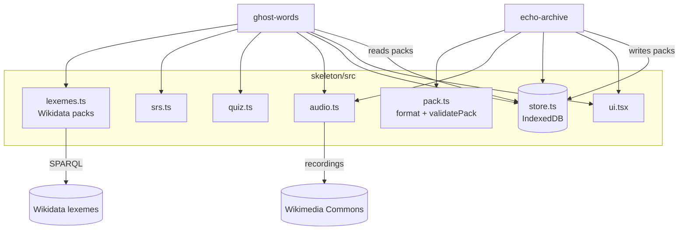

# Design: Last Words

## Overview

## Pack format (`last-words/pack@1`)
`{ format, id, name, endonym?, status?, origin: 'wikidata' | 'community', credit?, words: Word[], updated }`
`Word = { id, text, gloss, audio?: {kind:'url',url} | {kind:'local',key} | {kind:'data',dataUrl}, speaker?, license?, source? }`

Export turns `local` audio into `data` URLs; import turns `data` back into `local` blobs.

## Wikidata packs
Lexemes in the language with a form that has P443 (pronunciation audio) and a sense with an English definition, or else the English label of the sense's P5137 item. One word per lexeme and per spelling; Lingua Libre speaker read from the file name.

## Spaced repetition
Leitner boxes 1–5 with waits of 1 min, 10 min, 1 day, 3 days, 7 days. Right → box + 1; wrong → box 1. "Risen" = box ≥ 3. `pickNext`: most overdue review, else the first new word, else the soonest due, never the last word twice in a row if there's another.

## Correctness properties

| # | Property | Requirement |
| --- | --- | --- |
| P1 | `validatePack(JSON round trip of p) == p` for any valid pack | 1.3 |
| P2 | Any unsafe audio URL anywhere makes import fail | 1.2 |
| P3 | Junk input returns reasons, never throws | 1.2 |
| P4 | Slugs are URL-safe and non-empty | 3.1 |
| P5 | Box rules: in range, +1 on right, 1 on wrong, due = now + interval | 1.6, 2.4 |
| P6 | Learned after exactly 3 right answers in a row | 2.5 |
| P7 | `pickNext` order: overdue → new → soonest; no immediate repeats | 2.4 |
| P8 | Quiz options distinct, exactly one right | 2.3 |
| P9 | Lexeme parsing: unique ids and spellings, no blanks, https audio only | 2.2 |
| P10 | Waveform peaks: n bars in [0, 1], loudest = 1, silence = 0 | 1.5 |
